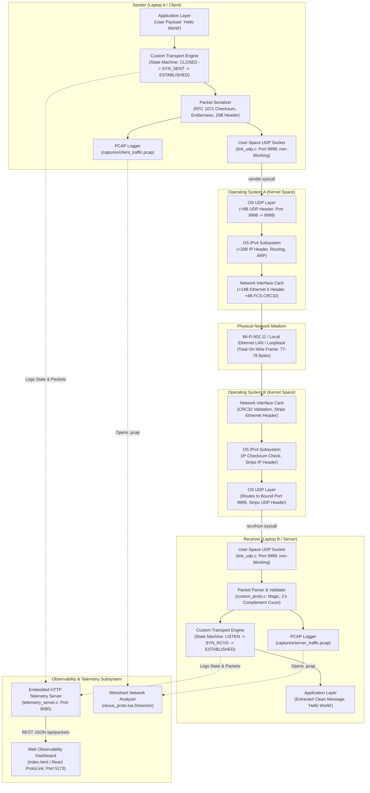
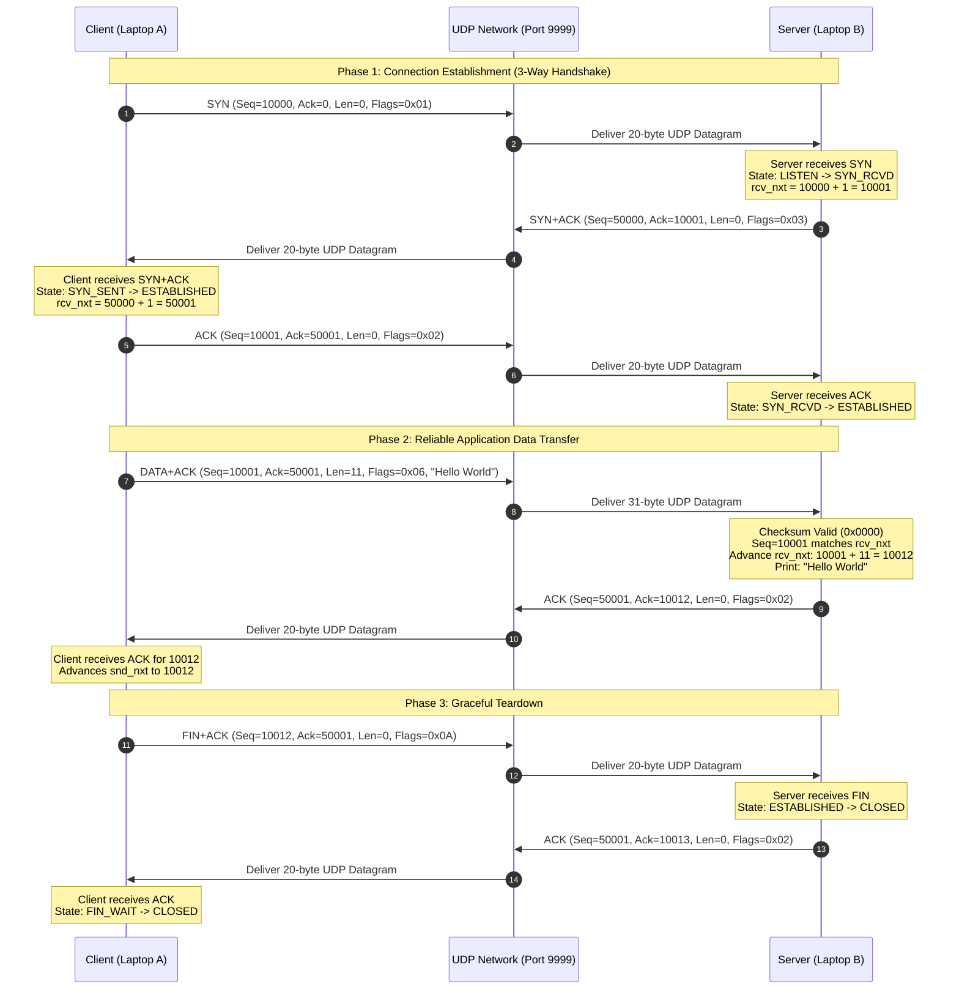

# 02. Architecture & Packet Flow

> **Document Focus**: Deep-dive into system architecture, on-wire packet layout, field serialization, and the step-by-step execution path of transmitting `"Hello World"` across the network.

---

## 1. System Architecture Diagram



---

## 2. Kernel Bypass vs. UDP Transport: Exact Reality

### The Truth About Kernel Bypassing in This Project
* **What is bypassed**: The operating system's built-in **TCP state machine and transport logic** is completely bypassed. The OS does not track our sequence numbers, does not send our ACKs, does not compute our checksums, does not manage our Reno congestion window, and does not enforce our 3-way handshake.
* **What is NOT bypassed**: The operating system kernel is **not** completely removed from the hardware path. We do not use kernel-bypass NIC drivers like DPDK or Intel AF_XDP. Instead, our C program creates a standard UDP socket (`AF_INET, SOCK_DGRAM`).
* **Why this is the industry-standard design choice**:
  1. **Zero Administrator/Root Privileges Needed**: Raw Layer-2 drivers (like Npcap or TAP) require elevated administrator privileges and specialized driver installation.
  2. **Routable Across Commercial Wi-Fi**: Ordinary consumer Wi-Fi access points and home routers drop custom Layer-2 EtherTypes (`0x88B5`), but seamlessly route standard UDP packets.
  3. **Industry Precedent**: This is the exact architectural pattern used by **Google QUIC / HTTP/3**, **WireGuard**, and **WebRTC**—running modern reliable transport logic in user space encapsulated within UDP datagrams.

---

## 3. Custom Wire Packet Format (`myproto_hdr_t`)

The custom transport header is exactly **20 bytes** long, defined in [`include/custom_proto.h`](file:///e:/Main%20Projects/CN%20Project/include/custom_proto.h#L31-L41) with strict `#pragma pack(push, 1)` byte packing.

```
 0                   1                   2                   3
 0 1 2 3 4 5 6 7 8 9 0 1 2 3 4 5 6 7 8 9 0 1 2 3 4 5 6 7 8 9 0 1
+-+-+-+-+-+-+-+-+-+-+-+-+-+-+-+-+-+-+-+-+-+-+-+-+-+-+-+-+-+-+-+-+
|       Magic ID (0xCAFE)       |    Version    |     Flags     |
+-+-+-+-+-+-+-+-+-+-+-+-+-+-+-+-+-+-+-+-+-+-+-+-+-+-+-+-+-+-+-+-+
|                        Sequence Number                        |
+-+-+-+-+-+-+-+-+-+-+-+-+-+-+-+-+-+-+-+-+-+-+-+-+-+-+-+-+-+-+-+-+
|                     Acknowledgment Number                     |
+-+-+-+-+-+-+-+-+-+-+-+-+-+-+-+-+-+-+-+-+-+-+-+-+-+-+-+-+-+-+-+-+
|       Advertised Window       |         Payload Length        |
+-+-+-+-+-+-+-+-+-+-+-+-+-+-+-+-+-+-+-+-+-+-+-+-+-+-+-+-+-+-+-+-+
|       16-bit Checksum         |            Reserved           |
+-+-+-+-+-+-+-+-+-+-+-+-+-+-+-+-+-+-+-+-+-+-+-+-+-+-+-+-+-+-+-+-+
|                                                               |
|                   Application Data Payload                    |
|                      (Variable Length)                        |
|                                                               |
+-+-+-+-+-+-+-+-+-+-+-+-+-+-+-+-+-+-+-+-+-+-+-+-+-+-+-+-+-+-+-+-+
```

### Field-by-Field Breakdown

| Offset (Bytes) | Field Name | Width | Type / Endianness | Description & Role |
| :--- | :--- | :--- | :--- | :--- |
| **0 – 1** | `magic` | 16 bits | `uint16_t` (Big-Endian) | Fixed magic signature **`0xCAFE`**. Discards rogue packets immediately before parsing. |
| **2** | `version` | 8 bits | `uint8_t` | Protocol version (currently fixed at `1`). |
| **3** | `flags` | 8 bits | `uint8_t` (Bitmask) | Transport flags: `SYN (0x01)`, `ACK (0x02)`, `DATA (0x04)`, `FIN (0x08)`, `RST (0x10)`. |
| **4 – 7** | `seq_num` | 32 bits | `uint32_t` (Big-Endian) | Byte-level sequence number for ordered data stream and duplicate suppression. |
| **8 – 11** | `ack_num` | 32 bits | `uint32_t` (Big-Endian) | Cumulative acknowledgment number indicating the next expected byte. |
| **12 – 13** | `win_size` | 16 bits | `uint16_t` (Big-Endian) | Advertised receive window (default `65,535` B) for flow control. |
| **14 – 15** | `payload_len` | 16 bits | `uint16_t` (Big-Endian) | Length of the application payload immediately following the 20B header. |
| **16 – 17** | `checksum` | 16 bits | `uint16_t` (RFC 1071) | 16-bit 1's complement checksum calculated across the entire 20B header + payload. |
| **18 – 19** | `reserved` | 16 bits | `uint16_t` (Big-Endian) | Alignment padding, reserved for future extensions (currently `0x0000`). |
| **20+** | *Payload* | Variable | Raw binary bytes | Clean application message buffer (e.g., `"Hello World"`). |

---

## 4. How 11 Bytes of Payload Become 77 Bytes on the Wire

When a user transmits the 11-byte ASCII string `"Hello World"`, it expands through encapsulation:

```
[Layer 7 Application Payload: 11 Bytes]
                   ↓
[Layer 4 Custom Transport Header: +20 Bytes]  ==> 31 Bytes (UDP payload)
                   ↓
[Layer 4 Outer UDP Datagram Header: +8 Bytes]  ==> 39 Bytes (IP payload)
                   ↓
[Layer 3 Outer IPv4 Packet Header: +20 Bytes] ==> 59 Bytes (Ethernet payload)
                   ↓
[Layer 2 Ethernet II Frame Header: +14 Bytes]
[Layer 2 Frame Check Sequence (CRC32): +4 Bytes] ==> 77 Bytes Total On-Wire Frame
```

* **Custom Transport Segment**: $20\text{ B (Custom Header)} + 11\text{ B (Payload)} = \mathbf{31\text{ Bytes}}$.
* **Outer UDP Datagram**: $8\text{ B (UDP)} + 31\text{ B} = \mathbf{39\text{ Bytes}}$.
* **Outer IPv4 Packet**: $20\text{ B (IPv4)} + 39\text{ B} = \mathbf{59\text{ Bytes}}$.
* **Physical Ethernet Frame**: $14\text{ B (MAC)} + 59\text{ B} + 4\text{ B (CRC32)} = \mathbf{77\text{ Bytes}}$ ($616\text{ bits}$ on-wire).

---

## 5. End-to-End Execution: Transmitting "Hello World"

Here is the exact code trace of transmitting `"Hello World"` between two computers.

### Phase 1: 3-Way Handshake



---

### Step-by-Step Deep Dive: Sending "Hello World"

#### Step 1 — What the Sender Does
1. **Application Trigger**: In [`src/test_custom_stack.c:283`](file:///e:/Main%20Projects/CN%20Project/src/test_custom_stack.c#L283), the user enters `"Hello World"`. `strlen()` computes length = `11` bytes.
2. **Function Called**: [`serialize_custom_packet(tx_buf, sizeof(tx_buf), FLAG_DATA | FLAG_ACK, snd_nxt, rcv_nxt, 65535, "Hello World", 11)`](file:///e:/Main%20Projects/CN%20Project/src/custom_proto.c#L35).
3. **Serialization & Endianness**:
   * Header fields are converted to Network Byte Order (Big Endian):
     * `magic = htons(0xCAFE)`
     * `version = 1`, `flags = 0x06 (DATA | ACK)`
     * `seq_num = htonl(10001)`
     * `ack_num = htonl(50001)`
     * `win_size = htons(65535)`
     * `payload_len = htons(11)`
     * `checksum = 0`
   * `memcpy(out_buffer + 20, "Hello World", 11)` copies payload to offset 20.
4. **Checksum Calculation**:
   * [`compute_checksum(out_buffer, 31)`](file:///e:/Main%20Projects/CN%20Project/src/custom_proto.c#L13) sums 16-bit words using RFC 1071 1's complement logic across all 31 bytes.
   * `hdr->checksum` is written into bytes 16–17.
5. **On-Wire Transmission**:
   * [`link_send_frame(tx_buf, 31)`](file:///e:/Main%20Projects/CN%20Project/src/link_udp.c#L101) invokes `sendto(g_sock, tx_buf, 31, 0, &server_addr, sizeof(server_addr))`.
   * [`pcap_write_frame(tx_buf, 31, 1)`](file:///e:/Main%20Projects/CN%20Project/src/pcap_logger.c#L41) logs the outgoing packet to `captures/client_traffic.pcap`.

#### Step 2 — What Travels Through the Network
1. **Outer IP/UDP Framing**: The sender OS prepends an 8-byte UDP header (source port 9998, destination port 9999, length 39 bytes) and a 20-byte IPv4 header.
2. **On-Wire Bytes**: The physical network moves 77 bytes (Ethernet + IPv4 + UDP + CustomProto + Payload + FCS).
3. **Hex Breakdown of the Custom Segment (31 Bytes)**:
   ```
   0000: ca fe 01 06 00 00 27 11 00 00 c3 51 ff ff 00 0b  |......'....Q....|
   0010: a4 2c 00 00 48 65 6c 6c 6f 20 57 6f 72 6c 64     |.,..Hello World|
   ```
   * `ca fe`: Magic (`0xCAFE`)
   * `01`: Version 1
   * `06`: Flags (`DATA | ACK`)
   * `00 00 27 11`: Sequence `10001`
   * `00 00 c3 51`: Acknowledgment `50001`
   * `ff ff`: Window `65535`
   * `00 0b`: Payload length `11` bytes
   * `a4 2c`: Checksum
   * `00 00`: Reserved
   * `48 65 6c 6c 6f 20 57 6f 72 6c 64`: ASCII `"Hello World"`

#### Step 3 — What the Receiver Does
1. **Packet Ingestion**: In [`src/test_custom_stack.c:90`](file:///e:/Main%20Projects/CN%20Project/src/test_custom_stack.c#L90), `link_recv_frame(rx_buf, sizeof(rx_buf))` calls `recvfrom()`, returning 31 bytes.
2. **PCAP Recording**: `pcap_write_frame(rx_buf, 31, 0)` appends the raw incoming frame to `captures/server_traffic.pcap`.
3. **Parsing & Integrity Verification**:
   * [`parse_custom_packet(rx_buf, 31, &hdr, &payload)`](file:///e:/Main%20Projects/CN%20Project/src/custom_proto.c#L64) runs `compute_checksum(rx_buf, 31)`. The result is exactly `0x0000` (valid!).
   * Checks `magic == 0xCAFE`.
   * Unpacks fields to host byte order: `hdr.seq_num = 10001`, `hdr.payload_len = 11`.
4. **Sequence & Order Validation**:
   * Checks `if (hdr.seq_num == rcv_nxt)`: `10001 == 10001`. Exactly in order!
   * Advances expected sequence: `rcv_nxt = hdr.seq_num + hdr.payload_len = 10001 + 11 = 10012`.
5. **Application Delivery**:
   * Prints `Payload Message: "Hello World"` to console and generates formatted hex dump.
6. **Cumulative ACK Generation**:
   * Server calls `serialize_custom_packet(tx_buf, sizeof(tx_buf), FLAG_ACK, snd_nxt, 10012, 65535, NULL, 0)`.
   * Sends 20-byte pure ACK packet back to client.

#### Step 4 — What Proves That the Exchange Worked
1. **Server Console Output**:
   ```text
   >>> RX [CustomProto] Flags=[DATA ACK ] Seq=10001 Ack=50001 Win=65535 Len=11 (Total=31 bytes)
   [DATA RECEIVED] 11 bytes from client (Seq=10001):
      >>> Payload Message: "Hello World"
   [In-Order Data] Sequence validated. Advancing rcv_nxt -> 10012
   [Sending Cumulative ACK] Acknowledging Seq up to 10012
   <<< TX [CustomProto] Flags=[ACK ] Seq=50001 Ack=10012 Win=65535 Len=0 (Total=20 bytes)
   ```
2. **Client Console Output**:
   ```text
   <<< TX [CustomProto] Flags=[DATA ACK ] Seq=10001 Ack=50001 Win=65535 Len=11 (Total=31 bytes)
   >>> RX [CustomProto] Flags=[ACK ] Seq=50001 Ack=10012 Win=65535 Len=0 (Total=20 bytes)
   [SUCCESS] Remote peer acknowledged 11 bytes! (Ack=10012)
   ```
3. **Independent Wireshark Proof**: Opening `captures/client_traffic.pcap` in Wireshark with `nexus_proto.lua` displays:
   * Packet #1: `[SYN] Seq=10000 Ack=0 Len=0`
   * Packet #2: `[SYN] [ACK] Seq=50000 Ack=10001 Len=0`
   * Packet #3: `[ACK] Seq=10001 Ack=50001 Len=0`
   * Packet #4: `[DATA] [ACK] Seq=10001 Ack=50001 Len=11 Payload="Hello World"`
   * Packet #5: `[ACK] Seq=50001 Ack=10012 Len=0`
   * Packet #6: `[FIN] [ACK] Seq=10012 Ack=50001 Len=0`
   * Packet #7: `[ACK] Seq=50001 Ack=10013 Len=0`
